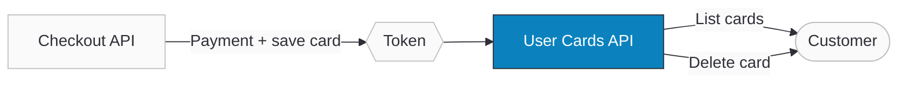

import Tabs from "@theme/Tabs";
import TabItem from "@theme/TabItem";
import CodeBlock from "@theme/CodeBlock";
import ApiDocEmbed from "@site/src/components/ApiDocEmbed";
import FAQ, { FAQItem } from '@site/src/components/FAQ';
import { OTTU_CONNECT_BASE_URL } from "@site/src/constants/api";

# User Cards

With Ottu, managing your customers' saved cards is straightforward and secure. The User Cards API lets you fetch all saved cards for a customer or delete a specific card. By incorporating this functionality, you ensure a seamless, personalized, and efficient payment experience.

:::info
User Cards API is not available in KSA.
:::

:::tip[Boost Your Integration]
Ottu offers SDKs and tools to speed up your integration. See [Getting Started](/developers/getting-started/#boost-your-integration) for all available options.
:::

## When to Use

- **Display saved cards** — show customers their previously tokenized cards at checkout for one-click payments.
- **Delete saved cards** — let customers or your backend remove cards they no longer want stored.
- **Build custom card management UI** — if the [Checkout SDK](/developers/payments/checkout-sdk/) doesn't fit your UX needs, use these APIs directly.
- **Pre-filter cards for auto-debit** — retrieve tokenized cards before initiating [recurring payments](/developers/cards-and-tokens/recurring-payments/).

## Setup

When integrating the User Cards API, here are the key points:

1. You will not receive the full card number (PAN). Instead, you'll get the last 4 digits and a [token](/glossary/#term-tokenization). This token is what you use for payments or authorizations.
2. If you're using the [Checkout SDK](/developers/payments/checkout-sdk/), customers can delete their saved cards themselves, unless an [auto-debit agreement](#deleting-a-card-that-has-an-auto-debit-agreement) is still running on the card. This gives users control over their payment information.
3. When a customer saves their card during payment, the corresponding token is included in the payload sent to your [webhook_url](/developers/payments/checkout-api/).
4. Ottu already handles displaying saved cards and card deletion. Use these APIs only if you need more granular control.

:::info[Successful Payment is a Prerequisite]
A saved card (token) can only be created after the customer completes a successful payment transaction. This ensures card validity and enables tokenization. See the [Tokenization documentation](/developers/cards-and-tokens/tokenization/#implementation) for implementation details.
:::

## Guide

### Workflow

1. **Customer pays and saves card** — during a [Checkout API](/developers/payments/checkout-api/) payment with tokenization enabled, Ottu creates a token.
2. **Token delivered via webhook** — the token is included in the webhook payload sent to your `webhook_url`.
3. **List saved cards** — call the User Cards API with `customer_id` to retrieve all saved cards (masked PAN + token).
4. **Delete a card** — call the delete endpoint with the card token to remove it.

### What your customer sees

When a customer taps delete on a saved card that is held by a running [auto-debit agreement](/developers/cards-and-tokens/recurring-payments/), the card is not deleted. The Checkout SDK (or your own card list) receives an explanation in the `detail` field, in the language of the `Accept-Language` header (English and Arabic are supported), and should show it to the customer as-is. The rules behind these messages are in [Deleting a card that has an auto-debit agreement](#deleting-a-card-that-has-an-auto-debit-agreement).

<CodeBlock language="json" title="400 Bad Request: recurring agreement still running">{`{
  "detail": "This card is linked to an auto-debit agreement active until 2026-12-31. Contact the merchant to cancel the agreement before deleting this card.",
  "result": "failed"
}`}</CodeBlock>

<CodeBlock language="json" title="400 Bad Request: ongoing agreement">{`{
  "detail": "This card is linked to an ongoing auto-debit agreement. Contact the merchant to cancel the agreement before deleting this card.",
  "result": "failed"
}`}</CodeBlock>

**`400 Bad Request`: the card is held by an agreement that Ottu tracks.**

| Case | Language | Message |
| --- | --- | --- |
| Dated | English | This card is linked to an auto-debit agreement active until `{expiry_date}`. Contact the merchant to cancel the agreement before deleting this card. |
| Dated | العربية | هذه البطاقة مرتبطة باتفاقية خصم تلقائي سارية حتى `{expiry_date}`. تواصل مع التاجر لإلغاء الاتفاقية قبل حذف هذه البطاقة. |
| Ongoing | English | This card is linked to an ongoing auto-debit agreement. Contact the merchant to cancel the agreement before deleting this card. |
| Ongoing | العربية | هذه البطاقة مرتبطة باتفاقية خصم تلقائي مستمرة. تواصل مع التاجر لإلغاء الاتفاقية قبل حذف هذه البطاقة. |

**`409 Conflict`: the card was saved through Ottu's own payment gateway (Ottu PG).**

| Language | Message |
| --- | --- |
| English | This card is linked to an active auto debit agreement and cannot be deleted. Pay once with another card to move the agreement, then delete this card. |
| العربية | هذه البطاقة مرتبطة باتفاقية خصم تلقائي نشطة ولا يمكن حذفها. ادفع مرة واحدة ببطاقة أخرى لنقل الاتفاقية، ثم احذف هذه البطاقة. |

`{expiry_date}` is the end date of the agreement, always written as `YYYY-MM-DD` (for example `2026-12-31`). It is the `expiry_date` you sent in the `agreement` object, shown in that fixed form whatever format you sent it in.

### Step-by-Step

1. **Fetch saved cards** — call `GET /b/pbl/v2/card/?customer_id={id}` to retrieve all tokenized cards for a customer.
2. **Display cards** — show the masked card number, brand, and expiry in your UI.
3. **Delete a card** — as the cardholder (public key, [below](#delete-as-the-cardholder)) or as the merchant (private key, [below](#delete-as-the-merchant)). A cardholder's delete can be refused when an auto-debit agreement still holds the card; see [Handle a refusal](#handle-a-refusal).
4. **Use a card for payment** — pass the token to the [Checkout API](/developers/payments/checkout-api/) or [Auto-Debit API](/developers/payments/native-payments/) for subsequent charges.

#### Delete as the cardholder

The Checkout SDK calls this for you when a customer taps delete on a saved card. If you build your own card list, call the session route with your **public** key (see [Authentication](/developers/getting-started/authentication/#public-key)). The session must belong to the same customer as the card and must not have expired.

Replace the placeholders:

- `<CARD_TOKEN>` — the token of the saved card, from the [webhook payload](/developers/payments/checkout-api/) or the cards list.
- `<SESSION_ID>` — the `session_id` of the [Checkout API](/developers/payments/checkout-api/) session the customer is on.
- `<YOUR_PUBLIC_KEY>` — your public API key (the one the Checkout SDK uses).

<Tabs groupId="language">
<TabItem value="curl" label="cURL" default>

<CodeBlock language="bash" title="Cardholder deletes a saved card">{`curl --request DELETE '${OTTU_CONNECT_BASE_URL}/b/pbl/v2/card/<CARD_TOKEN>/session/<SESSION_ID>/' \\
  --header 'Authorization: Api-Key <YOUR_PUBLIC_KEY>' \\
  --header 'Accept-Language: en'`}</CodeBlock>

</TabItem>
<TabItem value="python" label="Python">

<CodeBlock language="python" title="Cardholder deletes a saved card">{`import requests

response = requests.delete(
    "${OTTU_CONNECT_BASE_URL}/b/pbl/v2/card/<CARD_TOKEN>/session/<SESSION_ID>/",
    headers={"Authorization": "Api-Key <YOUR_PUBLIC_KEY>", "Accept-Language": "en"},
)

if response.status_code == 204:
    print("Card deleted")
elif response.status_code in (400, 409):
    # Show this text to the customer as-is: it is already translated.
    print(response.json()["detail"])
elif response.status_code == 401:
    print("Check the Authorization header and the public key")
elif response.status_code == 404:
    print("Card cannot be deleted from this session")
elif response.status_code == 429:
    print("Too many requests, wait and retry")
else:
    print("Not deleted:", response.status_code)`}</CodeBlock>

</TabItem>
<TabItem value="node" label="Node.js">

<CodeBlock language="javascript" title="Cardholder deletes a saved card">{`const response = await fetch(
  "${OTTU_CONNECT_BASE_URL}/b/pbl/v2/card/<CARD_TOKEN>/session/<SESSION_ID>/",
  {
    method: "DELETE",
    headers: { Authorization: "Api-Key <YOUR_PUBLIC_KEY>", "Accept-Language": "en" },
  }
);

if (response.status === 204) {
  console.log("Card deleted");
} else if (response.status === 400 || response.status === 409) {
  // Show this text to the customer as-is: it is already translated.
  console.log((await response.json()).detail);
} else if (response.status === 401) {
  console.log("Check the Authorization header and the public key");
} else if (response.status === 404) {
  console.log("Card cannot be deleted from this session");
} else if (response.status === 429) {
  console.log("Too many requests, wait and retry");
} else {
  console.log("Not deleted:", response.status);
}`}</CodeBlock>

</TabItem>
<TabItem value="php" label="PHP">

<CodeBlock language="php" title="Cardholder deletes a saved card">{`<?php
$ch = curl_init("${OTTU_CONNECT_BASE_URL}/b/pbl/v2/card/<CARD_TOKEN>/session/<SESSION_ID>/");
curl_setopt_array($ch, [
    CURLOPT_CUSTOMREQUEST => "DELETE",
    CURLOPT_HTTPHEADER => ["Authorization: Api-Key <YOUR_PUBLIC_KEY>", "Accept-Language: en"],
    CURLOPT_RETURNTRANSFER => true,
]);
$body = curl_exec($ch);
$status = curl_getinfo($ch, CURLINFO_HTTP_CODE);
curl_close($ch);

if ($status === 204) {
    echo "Card deleted";
} elseif ($status === 400 || $status === 409) {
    // Show this text to the customer as-is: it is already translated.
    echo json_decode($body, true)["detail"];
} elseif ($status === 401) {
    echo "Check the Authorization header and the public key";
} elseif ($status === 404) {
    echo "Card cannot be deleted from this session";
} elseif ($status === 429) {
    echo "Too many requests, wait and retry";
} else {
    echo "Not deleted: " . $status;
}`}</CodeBlock>

</TabItem>
</Tabs>

#### Delete as the merchant

From your server, call [`DELETE /b/pbl/v2/card/{token}/`](/developers/apis/delete-user-cards) with your **private** key (see [Authentication](/developers/getting-started/authentication/#api-key-auth)). The `customer_id` and `type` (`sandbox` or `production`) query parameters are required. The agreement rules do not apply to you, so the card is removed even while an agreement is running.

<Tabs groupId="language">
<TabItem value="curl" label="cURL" default>

<CodeBlock language="bash" title="Merchant deletes a saved card">{`curl --request DELETE '${OTTU_CONNECT_BASE_URL}/b/pbl/v2/card/<CARD_TOKEN>/?customer_id=<CUSTOMER_ID>&type=sandbox' \\
  --header 'Authorization: Api-Key <YOUR_PRIVATE_KEY>'`}</CodeBlock>

</TabItem>
<TabItem value="python" label="Python">

<CodeBlock language="python" title="Merchant deletes a saved card">{`import requests

response = requests.delete(
    "${OTTU_CONNECT_BASE_URL}/b/pbl/v2/card/<CARD_TOKEN>/",
    params={"customer_id": "<CUSTOMER_ID>", "type": "sandbox"},
    headers={"Authorization": "Api-Key <YOUR_PRIVATE_KEY>"},
)

if response.status_code == 204:
    print("Card deleted")
elif response.status_code == 400:
    print(response.json()["detail"])
elif response.status_code in (401, 403):
    print("Check the private key and its permissions")
else:
    print("Not deleted:", response.status_code)`}</CodeBlock>

</TabItem>
<TabItem value="node" label="Node.js">

<CodeBlock language="javascript" title="Merchant deletes a saved card">{`const query = new URLSearchParams({ customer_id: "<CUSTOMER_ID>", type: "sandbox" });
const response = await fetch(
  \`${OTTU_CONNECT_BASE_URL}/b/pbl/v2/card/<CARD_TOKEN>/?\${query}\`,
  { method: "DELETE", headers: { Authorization: "Api-Key <YOUR_PRIVATE_KEY>" } }
);

if (response.status === 204) {
  console.log("Card deleted");
} else if (response.status === 400) {
  console.log((await response.json()).detail);
} else if (response.status === 401 || response.status === 403) {
  console.log("Check the private key and its permissions");
} else {
  console.log("Not deleted:", response.status);
}`}</CodeBlock>

</TabItem>
<TabItem value="php" label="PHP">

<CodeBlock language="php" title="Merchant deletes a saved card">{`<?php
$query = http_build_query(["customer_id" => "<CUSTOMER_ID>", "type" => "sandbox"]);
$ch = curl_init("${OTTU_CONNECT_BASE_URL}/b/pbl/v2/card/<CARD_TOKEN>/?" . $query);
curl_setopt_array($ch, [
    CURLOPT_CUSTOMREQUEST => "DELETE",
    CURLOPT_HTTPHEADER => ["Authorization: Api-Key <YOUR_PRIVATE_KEY>"],
    CURLOPT_RETURNTRANSFER => true,
]);
$body = curl_exec($ch);
$status = curl_getinfo($ch, CURLINFO_HTTP_CODE);
curl_close($ch);

if ($status === 204) {
    echo "Card deleted";
} elseif ($status === 400) {
    echo json_decode($body, true)["detail"];
} elseif ($status === 401 || $status === 403) {
    echo "Check the private key and its permissions";
} else {
    echo "Not deleted: " . $status;
}`}</CodeBlock>

</TabItem>
</Tabs>

:::warning Deleting a card ends the agreement's charging
When you delete a card, its token is revoked at the gateway, so later [auto-debit](/developers/payments/native-payments/) charges with that token cannot succeed. Delete a card with a running agreement only when you intend to stop it, and tell the customer.
:::

#### Handle a refusal

A refused cardholder delete leaves the card untouched and fully usable: Ottu checks the agreement **before** anything is revoked at the gateway. For the general error format, see [Error Codes](/developers/reference/error-codes/).

| HTTP status | When | What to do |
| --- | --- | --- |
| `204` | The card was deleted | Remove it from your UI |
| `400` | The card is held by a running or open-ended agreement (see the rules below), or `token` / `session_id` is longer than 128 characters | Show `detail` to the customer. Do not retry until the agreement has ended |
| `401` | No API key, or an invalid, revoked or expired one | Send `Authorization: Api-Key <YOUR_PUBLIC_KEY>` |
| `403` | A private key or dashboard user without the `card.delete_card` permission. It cannot happen with the public key, which is accepted without that permission check | Grant the permission to that key or user |
| `404` | Unknown or expired session, a session with no `customer_id`, a token that does not belong to the session's customer, or the card could not be deleted at its payment gateway (the gateway refused it, or offers no way to delete tokens). The body is `Not found.` (غير موجودة. in Arabic) | Treat the card as not deletable. The answer is deliberately the same for all of these, so a caller cannot probe for other customers' cards |
| `409` | The card was saved through Ottu PG and an auto-debit agreement is attached to it | Show `detail`. The customer can pay once with another card to move the agreement, then delete this card |
| `429` | More than 30 delete requests in a minute from one client IP address (the default limit) | Wait, then retry |

### Use Cases

#### Deleting a card that has an auto-debit agreement

A saved card can be linked to an [auto-debit agreement](/developers/cards-and-tokens/recurring-payments/): the customer's consent for you to charge the card again later. Deleting such a card would silently break that agreement, so Ottu does not let the **cardholder** delete it while the agreement is still running. **You** (the merchant) can always delete it.

Who is asking is decided only by the credential on the request, never by a parameter. A public key (the one embedded in the Checkout SDK) is always treated as the cardholder. A private key, or a signed-in dashboard user, is always treated as the merchant. The request carries no other way to claim a role.

**Which cards.** The agreement rules apply to cards Ottu holds itself, saved through a [payment gateway](/developers/payments/payment-methods/) that supports deleting tokens: Checkout.com, KNET V3, MPGS, Al Rajhi or STC Pay. A card saved through Ottu's own payment gateway (Ottu PG) is checked by Ottu PG instead, and a refused delete there answers `409` with its own message (see [What your customer sees](#what-your-customer-sees)).

**What counts as running.** For a card Ottu holds, a cardholder's delete is decided by the agreement's `type`:

| Agreement on the card | Cardholder (public key) | You (private key, or a dashboard user) |
| --- | --- | --- |
| None, or every agreement has ended | Deleted, `204 No Content` | Deleted |
| `recurring` with an `expiry_date` that has not passed | Refused, `400` with the end date | Deleted |
| `recurring` whose `expiry_date` is missing or cannot be read | Refused, `400`, "ongoing" message | Deleted |
| Any other type (`unscheduled`, `installment`, ...), with or without an `expiry_date` | Refused, `400`, "ongoing" message | Deleted |
| Agreement whose terms Ottu cannot find | Refused, `400`, "ongoing" message | Deleted |

Only `recurring` agreements are dated. An `installment` agreement is treated like any other open-ended type, so even if you sent it an `expiry_date`, it gives the "ongoing" message. The `type` defaults to `recurring` when you omit it.

A recurring agreement keeps blocking **up to and including** the day of its `expiry_date`, and stops blocking the next day. The `expiry_date` is the one you sent in the `agreement` object when the customer saved the card; see [Recurring Payments](/developers/cards-and-tokens/recurring-payments/). You can send it in any of the accepted date formats (the Recurring Payments example uses `01/04/2027`); the message always shows it as `YYYY-MM-DD`.

:::note
The end date is compared with today's calendar day in Ottu's time zone, Asia/Kuwait. A merchant in another time zone can see the card unblock earlier or later than their own local midnight.
:::

If a card is linked to **several** agreements, the message shows the **latest** end date among those still running, and ended ones are ignored. If any one of them is open-ended or cannot be read, the "ongoing" message is shown instead, because an open-ended agreement outlasts any dated one. When an agreement has been resumed with a new payment (the same `agreement.id`), the newest payment's terms are the ones that count.

:::note
The agreement check is for the cardholder only. It does not apply on the merchant route, or when you call the session route with your private key.
:::

## API Reference

<ApiDocEmbed path="get-user-cards.api.mdx" />

---

<ApiDocEmbed path="delete-user-cards.api.mdx" />

## Best Practices

- Show the `detail` text to the customer instead of a generic "could not delete" message. It already says who to contact and, when known, until when.
- Send `Accept-Language` so the message matches the customer's language.
- Hide or disable the delete button for a card you know has a running agreement, and keep the API answer as the final authority.
- Never ship your private key in a browser or mobile app. Customer-facing delete calls use the public key only.

## FAQ

<FAQ>
  <FAQItem question="Can I save a card without making a successful payment?">
    Not currently. A card can only be tokenized after a successful payment transaction. This ensures the card's validity.
  </FAQItem>
  <FAQItem question="How can I delete a card?">
    Two options: call the User Cards API [delete endpoint](/developers/apis/delete-user-cards) directly, or use the [Checkout SDK](/developers/payments/checkout-sdk/) which handles card management for you.
  </FAQItem>
  <FAQItem question="Why can't my customer delete a saved card?">
    The card is linked to an auto-debit agreement that is still running or has no end date. See [Deleting a card that has an auto-debit agreement](#deleting-a-card-that-has-an-auto-debit-agreement). You can still delete it with your private key.
  </FAQItem>
  <FAQItem question="Can I trigger auto-debit payments?">
    Yes, but only if the customer has agreed and their card is enabled for auto-debit. See the [Recurring Payments](/developers/cards-and-tokens/recurring-payments/) documentation.
  </FAQItem>
  <FAQItem question="Does Ottu store cards internally?">
    No. Card details are stored in an external PCI-compliant vault, typically at the [payment gateway](/developers/payments/payment-methods/) with which the merchant has a contract.
  </FAQItem>
</FAQ>

## What's Next?

- [**Recurring Payments**](/developers/cards-and-tokens/recurring-payments/) — Use saved tokens for auto-debit and recurring billing
- [**Tokenization**](/developers/cards-and-tokens/tokenization/) — How cards get saved during payment
- [**Checkout SDK**](/developers/payments/checkout-sdk/) — Drop-in UI that handles card management automatically
