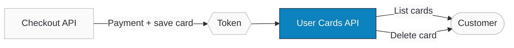

import Tabs from "@theme/Tabs";
import TabItem from "@theme/TabItem";
import CodeBlock from "@theme/CodeBlock";
import ApiDocEmbed from "@site/src/components/ApiDocEmbed";
import FAQ, { FAQItem } from '@site/src/components/FAQ';
import { OTTU_CONNECT_BASE_URL } from "@site/src/constants/api";

# User Cards

With Ottu, managing your customers' saved cards is straightforward and secure. The User Cards API lets you fetch all saved cards for a customer or delete a specific card. By incorporating this functionality, you ensure a seamless, personalized, and efficient payment experience.

:::info
User Cards API is not available in KSA.
:::

:::tip[Boost Your Integration]
Ottu offers SDKs and tools to speed up your integration. See [Getting Started](/developers/getting-started/#boost-your-integration) for all available options.
:::

## When to Use

- **Display saved cards** — show customers their previously tokenized cards at checkout for one-click payments.
- **Delete saved cards** — let customers or your backend remove cards they no longer want stored.
- **Build custom card management UI** — if the [Checkout SDK](/developers/payments/checkout-sdk/) doesn't fit your UX needs, use these APIs directly.
- **Pre-filter cards for auto-debit** — retrieve tokenized cards before initiating [recurring payments](/developers/cards-and-tokens/recurring-payments/).

## Setup

When integrating the User Cards API, here are the key points:

1. You will not receive the full card number (PAN). Instead, you'll get the last 4 digits and a token. This token is what you use for payments or authorizations.
2. If you're using the [Checkout SDK](/developers/payments/checkout-sdk/), customers can delete their saved cards at any point. This gives users control over their payment information.
3. When a customer saves their card during payment, the corresponding token is included in the payload sent to your [webhook_url](/developers/payments/checkout-api/).
4. Ottu already handles displaying saved cards and card deletion. Use these APIs only if you need more granular control.

:::info[Successful Payment is a Prerequisite]
A saved card (token) can only be created after the customer completes a successful payment transaction. This ensures card validity and enables tokenization. See the [Tokenization documentation](/developers/cards-and-tokens/tokenization/#implementation) for implementation details.
:::

## Guide

### Workflow

1. **Customer pays and saves card** — during a [Checkout API](/developers/payments/checkout-api/) payment with tokenization enabled, Ottu creates a token.
2. **Token delivered via webhook** — the token is included in the webhook payload sent to your `webhook_url`.
3. **List saved cards** — call the User Cards API with `customer_id` to retrieve all saved cards (masked PAN + token).
4. **Delete a card** — call the delete endpoint with the card token to remove it.

### Step-by-Step

1. **Fetch saved cards** — call `GET /b/pbl/v2/card/?customer_id={id}` to retrieve all tokenized cards for a customer.
2. **Display cards** — show the masked card number, brand, and expiry in your UI.
3. **Delete a card** — call `DELETE /b/pbl/v2/card/{token}/` to remove a specific card.
4. **Use a card for payment** — pass the token to the [Checkout API](/developers/payments/checkout-api/) or [Auto-Debit API](/developers/payments/native-payments/) for subsequent charges.

## Deleting a Card That Has an Auto-Debit Agreement

A saved card can be linked to an [auto-debit agreement](/developers/cards-and-tokens/recurring-payments/) — the customer's consent for you to charge the card again later. Deleting such a card would silently break that agreement, so Ottu does not let the **cardholder** delete it while the agreement is still running. **You** (the merchant) can always delete it.

This applies to cards saved with a gateway that Ottu integrates directly, for example MPGS, Checkout.com, Al Rajhi and STC Pay.

### Who can delete what

| Card | Deleted by the cardholder (Checkout SDK, or your own UI using the public key) | Deleted by you (private key, or a dashboard user) |
| --- | --- | --- |
| No agreement, or every agreement has ended | Yes — `204 No Content` | Yes |
| Recurring agreement still running | No — `400`, the message shows the end date | Yes |
| Unscheduled agreement | No — `400`, "ongoing" message | Yes |
| Agreement terms Ottu cannot read | No — `400`, "ongoing" message | Yes |

A recurring agreement is still running **up to and including** the day of its `expiry_date`. It stops blocking from the next day. The `expiry_date` is the one you sent in the `agreement` object when the customer saved the card — see [Recurring Payments](/developers/cards-and-tokens/recurring-payments/).

:::note
Who is asking is decided by the credential on the request, never by a parameter. A public key (the one embedded in the Checkout SDK) is always treated as the cardholder; a private key or a signed-in dashboard user is always treated as the merchant. Adding extra query parameters does not change this.
:::

### Quick implementation

The Checkout SDK calls this for you when a customer taps delete on a saved card. If you build your own card list, call the session route with your **public** key. The session must belong to the same customer as the card and must not have expired.

<Tabs groupId="language">
<TabItem value="curl" label="cURL" default>

<CodeBlock language="bash" title="Cardholder deletes a saved card">{`curl --request DELETE '${OTTU_CONNECT_BASE_URL}/b/pbl/v2/card/<CARD_TOKEN>/session/<SESSION_ID>/' \\
  --header 'Authorization: Api-Key <YOUR_PUBLIC_KEY>' \\
  --header 'Accept-Language: en'`}</CodeBlock>

</TabItem>
<TabItem value="python" label="Python">

<CodeBlock language="python" title="Cardholder deletes a saved card">{`import requests

response = requests.delete(
    "${OTTU_CONNECT_BASE_URL}/b/pbl/v2/card/<CARD_TOKEN>/session/<SESSION_ID>/",
    headers={"Authorization": "Api-Key <YOUR_PUBLIC_KEY>", "Accept-Language": "en"},
)

if response.status_code == 204:
    print("Card deleted")
elif response.status_code == 400:
    # Show this text to the customer as-is: it is already translated.
    print(response.json()["detail"])
else:
    print("Not deleted:", response.status_code)`}</CodeBlock>

</TabItem>
<TabItem value="node" label="Node.js">

<CodeBlock language="javascript" title="Cardholder deletes a saved card">{`const response = await fetch(
  "${OTTU_CONNECT_BASE_URL}/b/pbl/v2/card/<CARD_TOKEN>/session/<SESSION_ID>/",
  {
    method: "DELETE",
    headers: { Authorization: "Api-Key <YOUR_PUBLIC_KEY>", "Accept-Language": "en" },
  }
);

if (response.status === 204) {
  console.log("Card deleted");
} else if (response.status === 400) {
  // Show this text to the customer as-is: it is already translated.
  console.log((await response.json()).detail);
} else {
  console.log("Not deleted:", response.status);
}`}</CodeBlock>

</TabItem>
<TabItem value="php" label="PHP">

<CodeBlock language="php" title="Cardholder deletes a saved card">{`<?php
$ch = curl_init("${OTTU_CONNECT_BASE_URL}/b/pbl/v2/card/<CARD_TOKEN>/session/<SESSION_ID>/");
curl_setopt_array($ch, [
    CURLOPT_CUSTOMREQUEST => "DELETE",
    CURLOPT_HTTPHEADER => ["Authorization: Api-Key <YOUR_PUBLIC_KEY>", "Accept-Language: en"],
    CURLOPT_RETURNTRANSFER => true,
]);
$body = curl_exec($ch);
$status = curl_getinfo($ch, CURLINFO_HTTP_CODE);

if ($status === 204) {
    echo "Card deleted";
} elseif ($status === 400) {
    // Show this text to the customer as-is: it is already translated.
    echo json_decode($body, true)["detail"];
}`}</CodeBlock>

</TabItem>
</Tabs>

### What the customer sees

When the card is refused, the response is `400 Bad Request` with the explanation in `detail`, in the language of the `Accept-Language` header (English and Arabic are supported):

<CodeBlock language="json" title="Recurring agreement still running">{`{
  "detail": "This card is linked to an auto-debit agreement active until 2026-12-31. Contact the merchant to cancel the agreement before deleting this card.",
  "result": "failed"
}`}</CodeBlock>

<CodeBlock language="json" title="Unscheduled agreement, or terms Ottu cannot read">{`{
  "detail": "This card is linked to an ongoing auto-debit agreement. Contact the merchant to cancel the agreement before deleting this card.",
  "result": "failed"
}`}</CodeBlock>

| Language | Message |
| --- | --- |
| English (dated) | This card is linked to an auto-debit agreement active until `{date}`. Contact the merchant to cancel the agreement before deleting this card. |
| العربية (dated) | هذه البطاقة مرتبطة باتفاقية خصم تلقائي سارية حتى `{date}`. تواصل مع التاجر لإلغاء الاتفاقية قبل حذف هذه البطاقة. |
| English (ongoing) | This card is linked to an ongoing auto-debit agreement. Contact the merchant to cancel the agreement before deleting this card. |
| العربية (ongoing) | هذه البطاقة مرتبطة باتفاقية خصم تلقائي مستمرة. تواصل مع التاجر لإلغاء الاتفاقية قبل حذف هذه البطاقة. |

`{date}` is in `YYYY-MM-DD` form, exactly as stored.

If a card is linked to **several** agreements, the message shows the **latest** end date. If any one of them is unscheduled (or cannot be read), the "ongoing" message is shown instead, because an open-ended agreement outlasts any dated one. When an agreement has been resumed with a new payment, the newest payment's terms are the ones that count.

:::warning A refused delete leaves the card fully usable
Ottu checks the agreement **before** anything is revoked at the gateway. A refused delete does not touch the token, so the card keeps working for the running agreement.
:::

### Errors

| HTTP status | When | What to do |
| --- | --- | --- |
| `204` | The card was deleted | Remove it from your UI |
| `400` | The card is linked to a running or unscheduled agreement | Show `detail` to the customer. Do not retry until the agreement has ended |
| `401` | No API key, or an invalid one | Send `Authorization: Api-Key <YOUR_PUBLIC_KEY>` |
| `404` | Unknown or expired session, a token that does not belong to the session's customer, or the gateway refused to delete the card | Treat the card as not deletable. The answer is deliberately the same for all of these, so a caller cannot probe for other customers' cards |
| `429` | Too many delete requests from one address | Wait, then retry |

### Deleting as the merchant

Call [`DELETE /b/pbl/v2/card/{token}/`](#api-reference) with your **private** key (or from the dashboard). The agreement rules above do not apply to you, so the card is removed even while an agreement is running.

:::warning Deleting a card ends the agreement's charging
When you delete a card, its token is revoked at the gateway, so later [auto-debit](/developers/payments/native-payments/) charges with that token cannot succeed. Delete a card with a running agreement only when you intend to stop it, and tell the customer.
:::

### Best practices

:::tip
- Show the `detail` text to the customer instead of a generic "could not delete" message. It already says who to contact and, when known, until when.
- Send `Accept-Language` so the message matches the customer's language.
- Hide or disable the delete button for a card you know has a running agreement, and keep the API answer as the final authority.
- Never ship your private key in a browser or mobile app. Customer-facing delete calls use the public key only.
:::

## API Reference

<ApiDocEmbed path="get-user-cards.api.mdx" />

---

<ApiDocEmbed path="delete-user-cards.api.mdx" />

## FAQ

<FAQ>
  <FAQItem question="Can I save a card without making a successful payment?">
    Not currently. A card can only be tokenized after a successful payment transaction. This ensures the card's validity.
  </FAQItem>
  <FAQItem question="How can I delete a card?">
    Two options: call the User Cards API [delete endpoint](#api-reference) directly, or use the [Checkout SDK](/developers/payments/checkout-sdk/) which handles card management for you.
  </FAQItem>
  <FAQItem question="Why can't my customer delete a saved card?">
    The card is linked to an auto-debit agreement that is still running or has no end date. See [Deleting a card that has an auto-debit agreement](#deleting-a-card-that-has-an-auto-debit-agreement). You can still delete it with your private key.
  </FAQItem>
  <FAQItem question="Can I trigger auto-debit payments?">
    Yes, but only if the customer has agreed and their card is enabled for auto-debit. See the [Recurring Payments](/developers/cards-and-tokens/recurring-payments/) documentation.
  </FAQItem>
  <FAQItem question="Does Ottu store cards internally?">
    No. Card details are stored in an external PCI-compliant vault, typically at the [payment gateway](/developers/payments/payment-methods/) with which the merchant has a contract.
  </FAQItem>
</FAQ>

## What's Next?

- [**Recurring Payments**](/developers/cards-and-tokens/recurring-payments/) — Use saved tokens for auto-debit and recurring billing
- [**Tokenization**](/developers/cards-and-tokens/tokenization/) — How cards get saved during payment
- [**Checkout SDK**](/developers/payments/checkout-sdk/) — Drop-in UI that handles card management automatically
